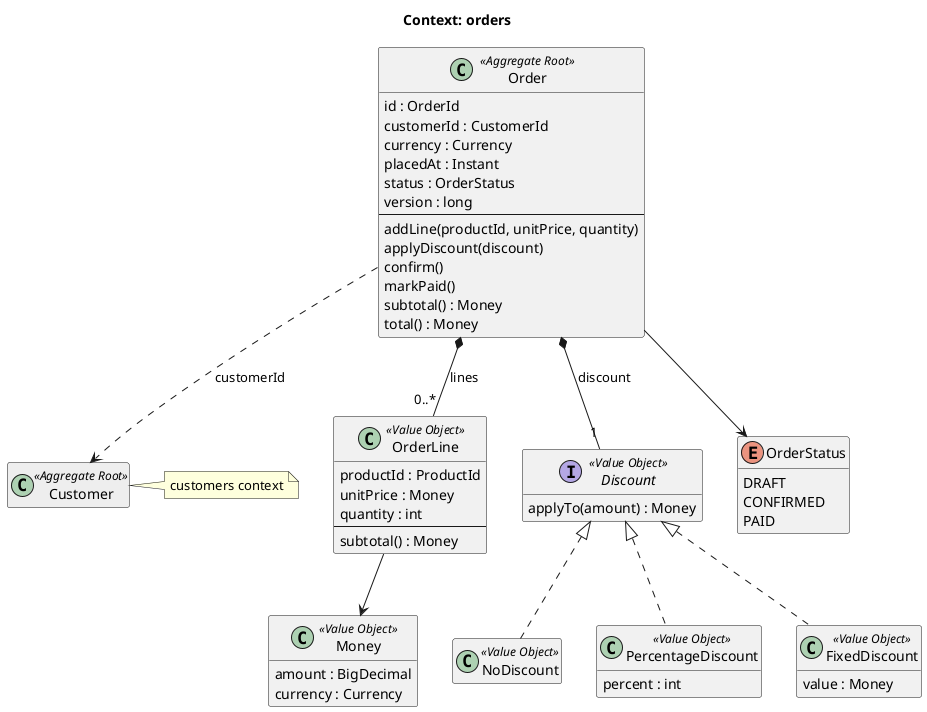
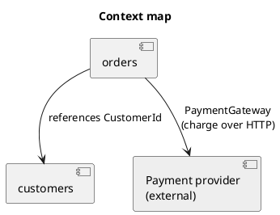

# Documentation references

An example `orders` context. Copy the shape (names, visibility, validation, `final`, structure), not the business: the domain is fictional.
The `//` comments explain the pattern for you; they are not copied into project code, which only carries comments about the why.
The code blocks are not compiled or run. The source of truth is the rules; if anything conflicts, the rules win.

Rules: `.claude/rules/docs.md`.

## Context diagram

`docs/diagrams/orders.puml`



## Context map

`docs/diagrams/context-map.puml`



## ADR

`docs/adr/0002-store-computed-total-in-orders.md`

````markdown
# 0002. Store the order's computed total in the orders table

## Status

Accepted

## Context

A customer's order list shows the total of each order. The total depends on the lines and the
applied discount, and that rule lives in the domain (`Order.total()`). The `OrderSummaries`
read port goes straight to SQL without loading aggregates, so it would have to repeat the
discount calculation in SQL.

Alternatives considered:

- Compute the total in SQL: duplicates a business rule and drifts out of sync when it changes.
- Load the aggregates in the list: respects the rule, but loads full orders with their lines
  just to show four fields.
- Store the total computed by the domain in a column when the order is saved.

## Decision

We will store the result of `Order.total()` in the `orders.total_amount` column every time
`MyBatisOrderRepository` saves an order. Read queries use that column and never compute
totals.

## Consequences

- The discount rule still exists in a single place: the domain.
- List queries are simple and fast.
- `total_amount` is derived data: it is never written outside `save()`. If the calculation
  rule changes, orders already saved keep the old total until they are saved again; if they
  need to be recalculated, it will be done with an explicit migration.
````
