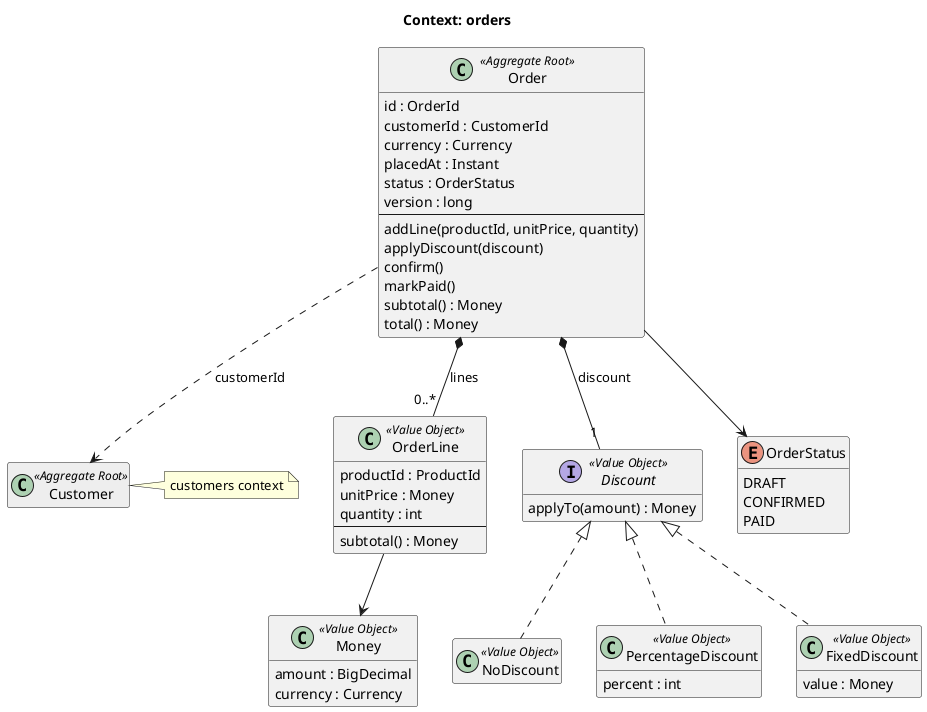
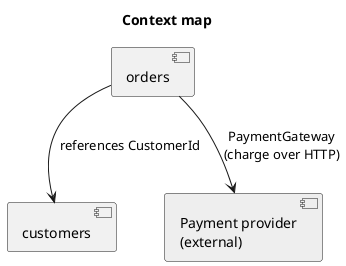

# Documentation references

An example `orders` context. Copy the shape (names, visibility, validation, `final`, structure), not the business: the domain is fictional.
The `//` comments explain the pattern for you; they are not copied into project code, which only carries comments about the why.
The code blocks are not compiled or run. The source of truth is the rules; if anything conflicts, the rules win.

Rules: `.github/instructions/docs.instructions.md`.

## Context diagram

`docs/diagrams/orders.puml`

## Context map

`docs/diagrams/context-map.puml`

